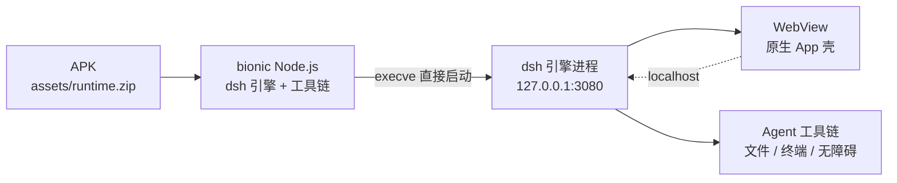

# DSH Mobile · DeepSeek Harness for Android

<p align="center">
  
</p>

<p align="center">
  <b>把完整的 Node.js Agent 引擎，以 Android 原生二进制打进 APK。</b><br>
  不套容器、不装发行版、不要 Root、不要 Termux、不要电脑。<br>
  <b>装完即用，冷启动 3 秒级。</b>
</p>

<p align="center">
  <a href="#-为什么快">为什么快</a> ·
  <a href="#-架构">架构</a> ·
  <a href="#-能力全景">能力全景</a> ·
  <a href="#-路线对比">路线对比</a> ·
  <a href="#-安装">安装</a> ·
  <a href="README_EN.md">English</a> ·
  <a href="README.de.md">Deutsch</a>
</p>

<!-- 徽章区：左边看"有多少人在用"，右边看"项目是否健康"。 -->
[](https://github.com/Soodok/Deepseek-Harness-Local-Android/releases)
[](https://github.com/Soodok/Deepseek-Harness-Local-Android/stargazers)
[](https://github.com/Soodok/Deepseek-Harness-Local-Android/releases/latest)

[](https://github.com/Soodok/Deepseek-Harness-Local-Android/actions/workflows/android-build.yml)


[](https://github.com/Soodok/Deepseek-Harness-Local-Android/commits/main)
[](https://github.com/Soodok/Deepseek-Harness-Local-Android#%E5%8F%8D%E9%A6%88)

---

## ⚡ 为什么快

这是本项目最核心的一条，值得单独讲。

**Android 上的 Agent 方案快不了，原因通常是架构性的。** 它们要么在手机上现搭 Linux 环境（Termux + apt），要么跑一层 proot 容器（glibc rootfs 500 MB～2 GB），要么打包一个冻结的 Termux 快照。这三条路的共同点是——**启动时要做的准备工作太多**：解压 rootfs、挂载伪文件系统、初始化软件源、装载环境变量。

DSH Mobile 走的是另一条路：**没有中间层**。

| 方案 | 跟引擎之间隔了什么 | 冷启动 |
|---|---|---|
| Termux 手动配置 | Perl/bash 启动链 + apt + 环境初始化 | 分钟级 |
| proot + Ubuntu | 内核 → proot 用户态 → glibc → 发行版 → Node | 十几秒起 |
| 冻结快照 | 解压 rootfs → 修补路径 → 启动 | 数十秒 |
| **DSH Mobile（本项目）** | **— 直接 `execve` bionic Node** | **3 秒级** |

关键在于：**我们把 dsh 需要的整套运行时，编译成 Android 原生（bionic）二进制，直接塞进 APK。** 运行时不需要「启动」，它本来就在那儿。冷启动真正做的事只有三件——解压（仅首启一次）、起 Node、等回环端口就绪。

### 实测数字

| 场景 | 设备 | 冷启动到引擎就绪 |
|---|---|---|
| 旗舰真机 | 一加 15T（Android 16） | **3.4 秒** |
| 主流机型 | 各品牌中端 Android | **5 ~ 6 秒** |
| 极端低端 | 紫光展锐手表（**3 GB 内存**） | **13 秒** |
| 模拟器 | x86_64 / 2.5 GB 内存 | **2.2 ~ 2.7 秒** |

作为参照：proot 系方案在不少中低端设备上**直接起不来**，主流机型上平均也要十几秒；Termux 手动配置首次需数分钟。

> 一台 3 GB 内存的紫光展锐手表能跑起来，本身就是架构的证明——同样的内存，proot + glibc 连 rootfs 都铺不开。

### 这些数字是怎么来的

不是调参调出来的，是几个设计决策叠加的结果：

| 设计决策 | 换来了什么 |
|---|---|
| **bionic 原生运行时**，不走 glibc、不套容器 | 省掉 proot 那层用户态翻译，也省掉 rootfs 解压与挂载 |
| 运行时**预置进 APK**（125 MB 压缩 / 404 MB 解压 / 14572 个文件） | 首次使用无需额外下载，装完即用，离线可启动 |
| `targetSdk = 28`（sideload 策略，与 Termux 同款） | 豁免 Android 10+ 的 W^X 限制，可直接 `execve` 私有目录下的二进制 |
| **CI 收集 + SONAME 去重 + SHA 校验**的运行时流水线 | 每次发布都是可复现产物，不是「我这台机器上能跑」 |
| 全部 `.so` 按 **16 KB 页对齐** | Android 15+ 的 16 KB 页内核设备直接可用 |
| 前端注入 **polyfill**（14 个现代 API） | WebView API 门槛从 Chrome 126 拉回到 **85**，国产 ROM 常见的 96 实测可用 |

---

## 🧱 架构



**分层职责很清晰**：

- **运行层（本项目负责）**：bionic Node 运行时、前台服务保活、三级权限、扩展中心、原生化 UI
- **引擎层（上游负责）**：插件体系、WebUI、工具调用链、会话持久化 —— 全部来自官方 dsh，原样保留

**这不是自研 Agent 框架。** 桌面上 dsh 能做的事，这里都能做；插件生态通用，能力上限跟着上游走。

---

## ✨ 能力全景

### 🖥️ 完整 Agent 执行，不是聊天壳

真 PTY 终端（自带 bash）、文件读写与编辑、命令执行、进程管理。Agent 能像在桌面上一样操作工作区——编译、跑测试、装依赖，都行。

### 🔌 扩展中心：把手机变成工作站

**21 项环境扩展**一键安装：Python、OpenJDK 17、Go、Rust、Ruby、PHP、Lua、Perl、Clang、CMake、Git、SQLite、FFmpeg、ImageMagick、OpenSSH、Vim、ADB 等。

- 国内镜像自动切换（清华 TUNA → 中科大 → 北外 → Termux 官方）
- 依赖闭包自动解析，逐包 SHA-256 校验 + 原子发布，**不会留下半套环境**
- 安装后自动修复 shebang，`env python3` 一类脚本直接可用
- **Agent 也能自己装**：Root 模式下已实测自装 Android SDK 命令行工具

### 🧩 社区插件：整个 dsh 生态

内置 **3540 个社区插件**目录（23 个分类，中英双语），搜索、看详情、一键装卸，全程不离开 App。

- 按兼容性分级过滤（纯 JS / 需原生模块 / 引擎 fork），减少「装上才发现用不了」的试错
- 安装进度与失败原因可见，完成后立即出现在 WebUI 插件面板

### 📱 原生竖屏 UI

不是把桌面界面硬缩小。三个客户端插件协同：侧栏全宽、设置面板重构、右侧面板全屏 —— 信息密度与触控热区都重新设计过。

### 🫧 悬浮窗 · 保活 · 无障碍

**这才是手机端相对桌面的增量价值**：

- **桌宠**：插件驱动的系统级悬浮窗，资源包制（多套素材可换）、动画链、气泡台词库
- **无障碍控制**：读屏 / 点击 / 输入 / 滑动 / 长按 / 拖拽等 **21 种原语**，多层视觉兜底 + 每步验证，实测约 1.45 秒/步
- **specialUse 前台服务 + 指数退避监督器**：扛住系统回收，长任务锁屏 / 后台持续运行
- **完成通知**：AI 操作进度、任务完成、局域网提醒

### 🔐 内置 SSH 远程工作区

手机连服务器改代码：远端工作区、Web 终端、隧道与 `ssh_*` 工具，全部内置。

### 🌐 从电脑打开原生 WebUI

局域网反向代理 + 6 位验证码，用电脑浏览器访问手机上的引擎 —— 大屏编辑、小屏执行。

### 🎙️ 语音输入

双通道识别（离线 + 云端），说完就能改、改完就能发。

### 🔐 三级权限

| 模式 | 能力 | 说明 |
|---|---|---|
| **普通** | 沙箱内运行 | 安全默认，AI 碰不到系统 |
| **Shizuku** | adb 级操作 | 免 Root，跑命令、保活、杀进程 |
| **Root** | 完整系统权限 | su 闸门管控，每次提权可见 |

---

## 🆚 路线对比

| | Termux 手动配置 | proot + Ubuntu | 冻结快照打包 | **DSH Mobile** |
|---|---|---|---|---|
| 冷启动 | 分钟级 | 十几秒起，部分设备起不来 | 数十秒 | **3 秒级** |
| 最弱设备 | 需自行折腾 | **3 GB 内存设备基本无望** | 看快照体积 | **3 GB 手表 13 秒** |
| 安装体验 | 装 Termux、配环境、装依赖 | 装容器与发行版 | 装即用 | **装即用** |
| 首次可用需下载 | 手动配置 | rootfs 500 MB～2 GB | 无 | **无** |
| 运行时 | 活环境（可扩展） | 容器内 glibc | 死快照，随包冻结 | **自建 bionic 闭包，CI 收集校验** |
| 许可证合规 | — | — | ⚠️ 快照打包 GPL 组件，合规存疑 | **仅含 MIT/BSD/ISC/Zlib 组件** |
| 权限分级 | 无 | 无 | 无 | **三级模式 + su 闸门 + Shizuku adb 桥** |
| 环境扩展 | 手动装 | apt | 死快照，不可扩展 | **21 项一键装 + AI 自助安装** |
| Termux 依赖 | 需要 Termux App | 需要 | 快照即 Termux | **零依赖**（硬编码路径已重定位） |

> 路线之间不是替代关系：Termux 系是在 Android 上**搭一个 Linux 环境**再跑 dsh；本项目把 dsh 需要的运行时**打进 APK**。**两条路线跑的是同一个 dsh**，差别在启动路径的长度。
>
> 📄 完整路线剖析见 **[docs/android-agent-routes.zh.md](docs/android-agent-routes.zh.md)**（[English](docs/android-agent-routes.md)）。

---

## 📦 安装

**从 Release 下载（推荐）**：前往 [Releases](https://github.com/Soodok/Deepseek-Harness-Local-Android/releases) 下载 APK，允许安装未知来源应用后安装。手机选 `arm64-v8a`。

**两种包怎么选**：

| 包 | 体积 | 适合 |
|---|---|---|
| **完整包**（`-release.apk`） | ~150 MB | 绝大多数人。运行时预置，装完即用，离线也能启动 |
| **简单包**（`-release-noruntime.apk`） | ~24 MB | 空间紧张，或想走云端更新运行时。首启需联网下载约 125 MB |

> 两种包**功能完全相同**，只差运行时是否内置。共用一个签名，可互相覆盖升级。

### 环境要求

- **Android 8.0 ~ 16**（`minSdk 26`）
- **WebView ≥ Chrome 85**（国产 ROM 常见的 96 实测可用；构建时注入 polyfill，把 API 门槛从 126 拉回 85）
- 存储：约 720 MB（APK + 解压后运行时）

---

## 🚀 快速上手

1. 安装 APK，首次启动走引导（语言 / 朝向 / 主题 / 权限模式）
2. 等引擎就绪（状态栏显示 `Engine ready`）
3. 在设置里填入模型 API Key，或登录 DeepSeek 账号
4. 选一个工作区，开始对话

**想做开发任务**：设置 → 扩展中心，装 Python / Git / Node 等；然后告诉 AI 要做什么。

---

## 🔧 从源码构建

```bash
# 前置：JDK 17+、Android SDK 36、Node 22、Python 3

# 1) 收集运行时（从 Termux 仓库拉 bionic 包 + 打 Android 补丁）
./scripts/build-runtime.sh --abi arm64-v8a --out _runtime_bak/rt-arm64.zip

# 2) 构建 APK
gradle :app:assembleDebug -Pabi=arm64-v8a -Ppackage=full \
       -PruntimeZip=$PWD/_runtime_bak/rt-arm64.zip

# 输出：app/build/outputs/apk/debug/app-debug.apk
```

流水线细节（去重、PTC 补丁、polyfill 注入、`BUILD.json`、索引签名、发布流程）见 **[docs/git-workflow.md](docs/git-workflow.md)** 与 **[docs/RELEASE.md](docs/RELEASE.md)**。

---

## 📚 深度文档

每一项能力都有独立文档（设计取舍、实测数据、排障清单）：

| 文档 | 内容 |
|---|---|
| [无障碍控制](docs/ACCESSIBILITY.md) | 21 种原语；多层视觉兜底、每步验证；实测 ~1.45 s/步 |
| [SSH 远程工作区](docs/SSH.md) | 内置 @xiaopb/dsh-hardssh：远端工作区、Web 终端、隧道与 `ssh_*` 工具 |
| [闭环设计笔记](docs/LOCAL_CLOSED_LOOP.md) | 端侧决策引擎的设计与演进记录 |
| [竖屏 UI 插件](docs/NARROW_UI.md) | 侧栏全宽 / 设置面板重构 / 右侧面板全屏 |
| [局域网 WebUI](docs/LAN_WEBUI.md) | 反向代理、6 位验证码、常驻提醒与关闭链路 |
| [语音输入](docs/VOICE_INPUT.md) | 双通道识别、发送去重、面板停靠与已知问题 |
| [桌宠](docs/pet/README.md) | 系统级悬浮窗：安装与限制（[使用](docs/pet/PET_GUIDE.md)）、桥插件与内部逻辑（[架构](docs/pet/PET_ARCHITECTURE.md)）、[路线图](docs/pet/PET_ROADMAP.md) |
| [通知与后台行为](docs/NOTIFICATIONS.md) | AI 操作进度、任务完成、局域网提醒、退出彻底化 |
| [复杂场景实测](docs/COMPLEX_SCENARIOS.md) | 噪声页面、跨应用任务、失败恢复的实测记录 |
| [快速路径选择](docs/FAST_PATH_PICKER.md) | 端侧 UI 元素选择与判别 |
| [Git 工作流](docs/git-workflow.md) | 合并原则、推送通道、发版与验证清单、历史事故教训 |
| [发布与签名](docs/RELEASE.md) | 正式 key 保管与备份、GitHub Secrets、debug+release 构建、edge / tag 发布 |
| [版本发布说明归档](docs/release-notes/) | 各版本 `RELEASE_NOTES_*.md`（v1.3.0 起）集中存档 |

---

## ⛔ 边界（请知悉）

- **不是端侧大模型**：模型走你配置的 API，本 App 负责 Agent 运行时
- **不是手机自动化 App**：读屏点击只是 AI 可用的工具之一，不是产品定位
- **不做金融类应用**（合规红线）
- **无障碍能力有明确边界**：不注入不可检测的输入 —— 自动化与欺诈之间那条线我们不动
- **插件生态跟着上游走**：dsh 引擎锁 `0.2.1-rc.2`，上游插件 API 变更我们需要跟进

---

## ❓ FAQ

**Q：为什么 APK 这么大？**
A：完整包里塞了整套 Node 运行时 + 工具链（125 MB 压缩、404 MB 解压后）。换来的是「装完即用、离线可启动、冷启动 3 秒」。不想这样可以用 24 MB 的简单包。

**Q：为什么不走 proot？为什么用 `targetSdk 28`？**
A：proot 要多一层用户态翻译和 rootfs 解压，直接吃掉启动速度——也就吃掉了低端设备的可用性。`targetSdk 28` 是 sideload 分发策略，与 Termux 同款：豁免 Android 10+ 的 W^X，允许直接 `execve` 私有目录下的二进制。这是冷启动能压到 3 秒的前提之一。

**Q：Android 15 / 16 能用吗？**
A：能。全部 `.so` 按 16 KB 页对齐，适配 16 KB 页内核；界面依赖系统 WebView（需 Chrome 85+）。

**Q：数据存在哪？卸载会丢吗？**
A：引擎、凭证、工作区默认在应用私有目录（`files/dsh-home`），并自动外置到共享存储（`Documents/dshdata`，需「所有文件访问」权限）。**授权后卸载重装不丢**；未授权则随应用卸载删除。

**Q：需要 Root 吗？**
A：不需要。默认普通模式即可完整使用；Shizuku 提供 adb 级能力；Root 是可选增强。

**Q：和 DSHA / 其他移植版的区别？**
A：都能跑 dsh。差别在运行层架构与启动路径——见上方[路线对比](#-路线对比)，以及 [docs/android-agent-routes.zh.md](docs/android-agent-routes.zh.md)。

---

## ⚠️ 免责声明

本项目为社区移植，与 DeepSeek 官方无隶属关系。使用本软件产生的任何后果由使用者自行承担；请遵守当地法律法规与所接入模型服务的条款。

---

## 反馈

- **Issue**：[提交问题](https://github.com/Soodok/Deepseek-Harness-Local-Android/issues)（请附设备型号、Android 版本、App 版本与复现步骤）
- **QQ 群**：1128769016
- **Pull Request**：欢迎。合并用 `--no-ff` 保留提交线路，规范见 [docs/git-workflow.md](docs/git-workflow.md)

---

## 🙏 贡献者

感谢每一位提交 Issue、PR 与反馈的贡献者 —— 尤其是那些把复现时间线、`/proc` 证据、`ctime` 对比一起附上的报告，它们直接促成了多个架构级修复。

<a href="https://github.com/Soodok/Deepseek-Harness-Local-Android/graphs/contributors">
  
</a>

---

## 许可证

[MIT](./LICENSE) · 第三方组件许可见 [NOTICE](./NOTICE)
